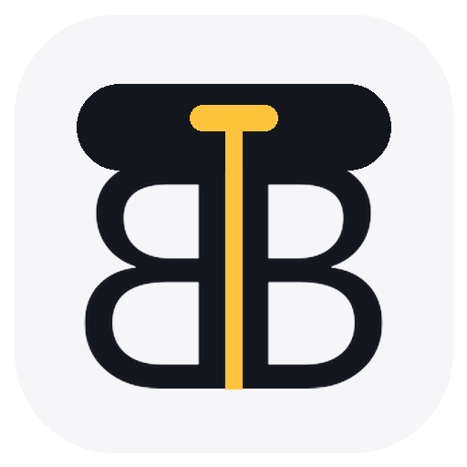
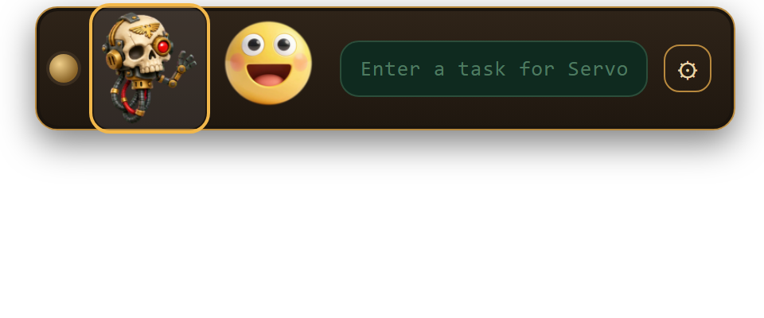
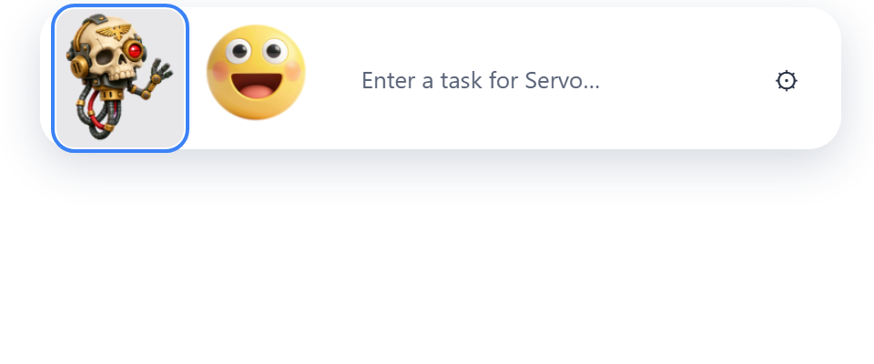
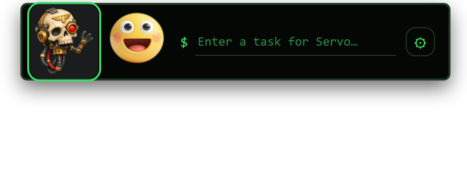
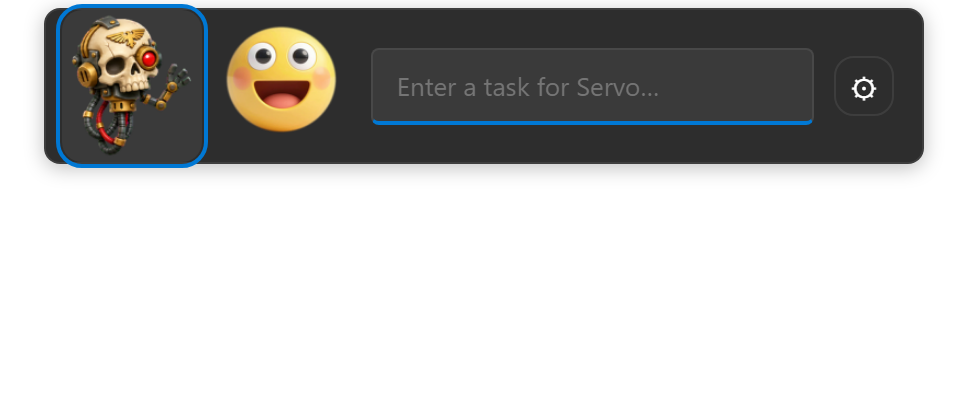
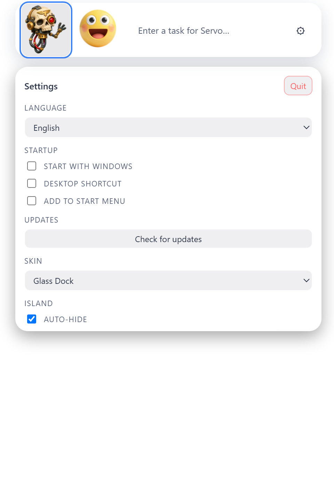

<p align="center">
  
</p>

<h1 align="center">BuddyBay</h1>

<p align="center">
  A floating, always-on-top island for Windows that shows what your AI agents are doing.
</p>

## What it is

BuddyBay sits at the top of your screen like a small car-radio bar. Animated buddies (pets) react to the state of your agents, and you can talk to them from the bar. Each buddy has its own model connection: local Ollama, Anthropic (Claude) or any OpenAI-compatible server such as LM Studio or llama.cpp.

- Multiple buddies, each with its own pet, size and model
- Skins: Brass Radio, Glass Dock, Terminal Pet and Windows (follows your system accent and light/dark mode)
- Auto-hide with a small grip, adjustable island size
- Start with Windows, Start menu and desktop shortcuts
- Auto-update from GitHub releases (signed installer)

## Screenshots

Four skins (Brass Radio, Glass Dock, Terminal Pet, Windows):

| Brass Radio | Glass Dock |
|---|---|
|  |  |
| **Terminal Pet** | **Windows** |
|  |  |

Settings panel (English, Glass Dock):



Czech UI is available in Settings > Language.

## Download

- **Installer (recommended):** [BuddyBay_0.1.2_x64-setup.exe](https://github.com/AlchKosac/BuddyBay/releases/download/v0.1.2/BuddyBay_0.1.2_x64-setup.exe)
- **ZIP (portable package with the installer and a short README):** [BuddyBay-0.1.2-windows.zip](https://github.com/AlchKosac/BuddyBay/releases/download/v0.1.2/BuddyBay-0.1.2-windows.zip)
- All releases: https://github.com/AlchKosac/BuddyBay/releases

Windows may show an "unknown publisher" warning, because the installer is not code-signed yet.

## Build from source

Requires Rust and WebView2 (included in Windows 11).

```bash
cargo run --manifest-path src-tauri/Cargo.toml
```

## Roadmap

1. Island behaviour: auto-hide, resize, multi-monitor placement
2. More pets and animation modes
3. Agent registry with per-agent connection settings (done: Ollama, Anthropic, OpenAI-compatible)
4. MCP connections
5. Voice input and output (local Whisper and TTS)
6. Profile sync between devices (settings only, no secrets) and an Android companion app
7. SteamOS packages

Czech version of the project notes: [docs/README.cs.md](docs/README.cs.md).

